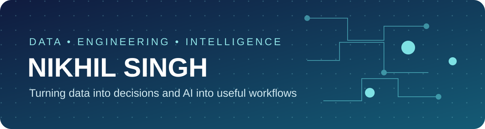
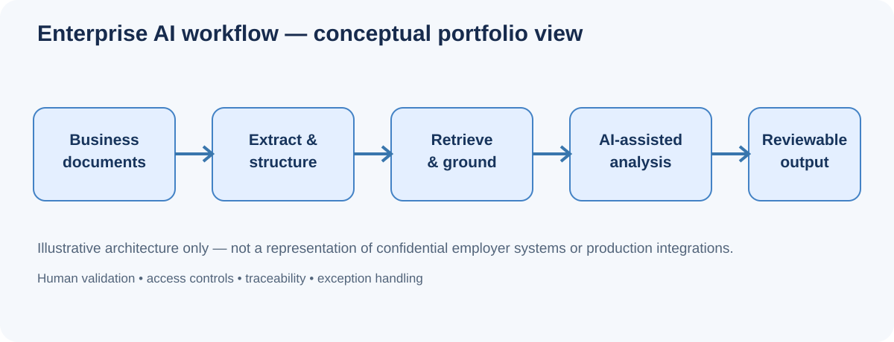
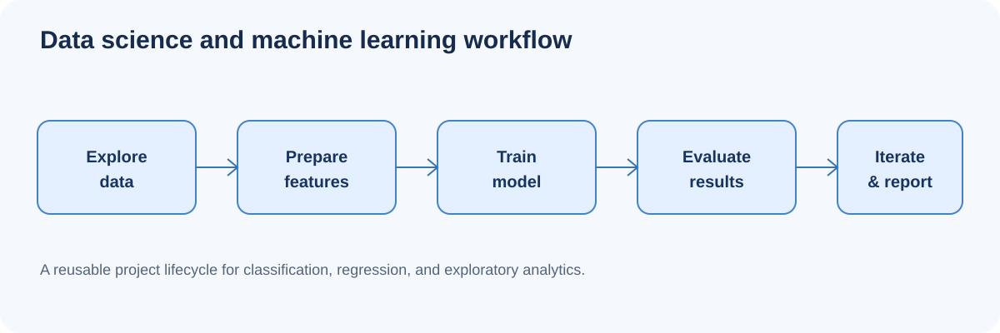

# Hi, I'm Nikhil Singh 👋

### Data & AI Professional | Generative AI | Analytics | Automation

I build data-driven solutions that connect **analytics, engineering, and applied AI**—from transforming data pipelines to developing intelligent assistants and machine-learning applications.

---

## About me

- Focused on **Data Engineering, Business Intelligence, Machine Learning, and Generative AI**.
- Interested in turning complex business workflows into practical, measurable data and AI solutions.
- Work across data preparation, analytics, automation, model development, and AI-assisted workflows.
- Enjoy building end-to-end prototypes and documenting the architecture behind them.

## Core skills

| Area | Technologies |
|---|---|
| Programming & data | Python, SQL, PySpark, Pandas, NumPy |
| BI & analytics | Power BI, DAX, Power BI Semantic Models, QlikView |
| Data engineering | Microsoft Fabric, Azure Data Factory, ADLS Gen2, Azure Synapse, Databricks |
| AI & GenAI | Azure OpenAI, Azure AI Search, RAG, document intelligence, prompt engineering |
| Automation & apps | Copilot Studio, Power Automate, Flask |
| Machine learning | Scikit-learn, TensorFlow/Keras, NLP, deep learning |

## Selected work

### Applied AI & automation

- **Debtor Collection Copilot – workflow concept:** An assistant-oriented approach to outstanding-invoice analysis, client follow-ups, prioritization, and response handling using structured business data.
- **AI-assisted contract review – workflow concept:** A document-analysis approach to extracting and organizing key information from vendor contracts for review.
- These are professional-work summaries only. No employer data, confidential documents, credentials, or proprietary implementation are published here.

### Public GitHub projects

- [Customer Churn Prediction](https://github.com/nikhil-singh09/Customer-churn-Prediction) — ANN-based customer churn modelling.
- [Bike Sharing Demand Prediction](https://github.com/nikhil-singh09/Bike-Sharing-Demand-Price-Prediction) — machine-learning capstone focused on bike-sharing demand.
- [Airbnb Data Analysis](https://github.com/nikhil-singh09/Air-bnb-data-analysis) — exploratory analysis of Airbnb booking data.
- [Google Play Store EDA](https://github.com/nikhil-singh09/PlaystoreEDA) — exploratory data analysis project.
- [Text-to-Speech / Voice Cloning](https://github.com/nikhil-singh09/Texttospeech) — experimentation with the Tortoise TTS framework.
- [Document Chatbot](https://github.com/nikhil-singh09/Chatbot) — a conversational interface for document-based queries.

## What I'm exploring

- Retrieval-Augmented Generation (RAG) and enterprise knowledge assistants
- Agentic workflows and responsible business process automation
- Scalable data pipelines and modern analytics platforms
- Production-minded ML: evaluation, monitoring, and clear documentation

## Let's connect

I'm interested in conversations around Data Engineering, Analytics, Applied AI, and Generative AI.

- **Portfolio:** https://nikhil-singh09-portfolio.netlify.app/
- **GitHub:** https://github.com/nikhil-singh09

---

*Building useful things with data, engineering, and AI.*

