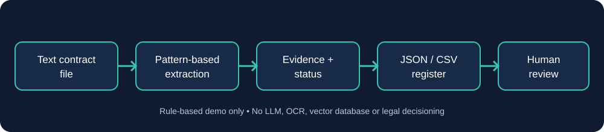

# AI-Assisted Contract Review — Portfolio Prototype

A privacy-conscious prototype for extracting review fields from plain-text contract documents and producing a structured review register. It is designed to demonstrate the document-analysis workflow behind a RAG-assisted contract review concept.

> **Important:** This repository is a standalone portfolio prototype using fictional sample clauses. It is not legal advice, does not determine enforceability, and is not the implementation or source code of any employer/client system. The current code uses transparent rule-based extraction; it does **not** call an LLM, OCR service, vector database or Azure service.



## What it does

- Reads text files from `data/contracts/`.
- Detects selected review signals such as parties, effective date, termination, governing law, liability cap and confidentiality.
- Records the source filename and extracted evidence snippets.
- Exports a JSON file and CSV review register for human review.

## Run

```bash
python -m venv .venv
# Windows: .venv\\Scripts\\activate
# macOS/Linux: source .venv/bin/activate
pip install -r requirements.txt
python src/review_contracts.py --input data/contracts --output outputs
```

## Review principles

- Every extracted value includes evidence text and a confidence label.
- Missing or ambiguous clauses are marked `Not found`; the script does not invent contract terms.
- A qualified reviewer must verify all findings against the complete agreement.
- Do not place confidential, personal or client contracts in this public repository.

## Conceptual RAG extension (not implemented)

A future version could add document parsing, chunking, embeddings, a vector index, retrieval-grounded generation, citation validation and a human approval interface. Any such integration should preserve document-level access controls, traceability and secure handling of source files.

## Sample data

The included contract is fictional and intentionally short. It is for demonstrating extraction only.
