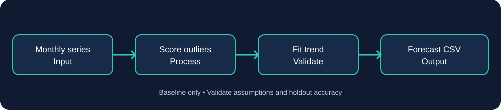

# Applied ML — Anomaly & Forecast Baseline

An explainable, dependency-light time-series baseline that flags unusual observations with a z-score and fits a straight-line trend for a short forecast horizon.

> This is a teaching baseline, not an ANN/LSTM implementation or production forecast. Results are illustrative and need domain validation.

## Run
python src/analyze_series.py --input data/monthly_demand.csv --output demo-output --horizon 3

## Outputs
- scored_series.csv with anomaly scores and trend values
- forecast.csv with the next periods

The demo is intentionally transparent so assumptions can be reviewed before using a more advanced model.

## Bundled demo output

A sample run using the included fictional inputs is saved in `demo-output/`: scored_series.csv, forecast.csv. Run commands from this project folder to regenerate the artifacts.
