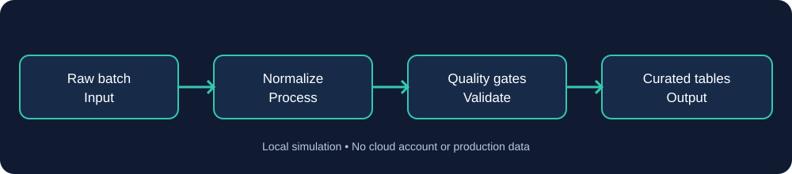

# Cloud Data Engineering & ETL Modernisation — Local Batch Demo

A local-only batch example showing schema checks, type normalization, rejects and curated aggregates.

> This is a portable Python demonstration. It does not connect to Azure, Fabric, ADLS, Spark or any client environment.

## Run
python src/curate_transactions.py --input data/transactions.csv --output outputs

## Outputs
- curated_transactions.csv: valid, normalized rows
- daily_region_summary.csv: daily amount totals by region
- rejected_rows.csv: rows held with a reason

The examples are fictional. The architecture concepts map to orchestration, transformation and quality gates; no cloud deployment is included.