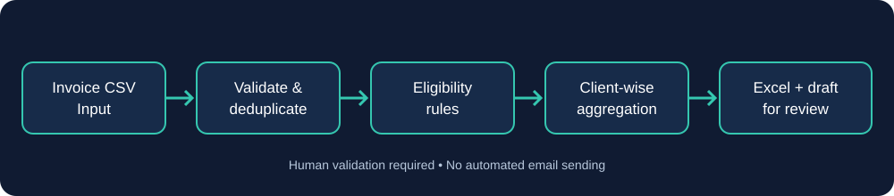

# Debtor Collection Copilot — Safe Demo

A portfolio implementation of an accounts-receivable follow-up workflow using Python, pandas and Excel. It demonstrates how invoice-level records can be validated, deduplicated, prioritised and consolidated into a client-wise worklist.

> **Portfolio demo:** This repository is independently recreated with synthetic data. It is not the source code, a deployment, or a representation of any employer's internal systems. It does not send email or connect to Outlook, Power BI, SharePoint or Copilot Studio.



## Workflow

1. Load invoice records from CSV.
2. Validate required fields and numeric/date values.
3. Keep records meeting the configurable eligibility rules (default: more than 90 overdue days and outstanding above 100,000).
4. Deduplicate by client reference and invoice number.
5. Rank eligible invoices by outstanding amount.
6. Consolidate invoices by client and export an Excel worklist plus email-preview text.

## Run

```bash
python -m venv .venv
# Windows: .venv\\Scripts\\activate
# macOS/Linux: source .venv/bin/activate
pip install -r requirements.txt
python src/build_worklist.py --input data/sample_invoices.csv --output outputs
```

The sample dataset is fictional. Output files are created locally under `outputs/`.

## Configuration

Edit the constants at the top of `src/build_worklist.py` to change the overdue-day and outstanding thresholds. The script deliberately produces drafts only; a human must validate client identity, totals and recipients before any real communication.

## Data fields

`client_ref, client_name, invoice_no, invoice_date, due_date, days_overdue, outstanding_amount, client_email`.

## Controls

- Required-field and amount validation
- Stable deduplication key
- No automatic email sending
- Synthetic sample data only
- No credentials or client records stored in the repository

## Next extensions

A production-grade implementation would add authenticated data access, role-based permissions, audit history, approved email integration, idempotency, retry handling and human approval gates. Those integrations are not implemented here.
