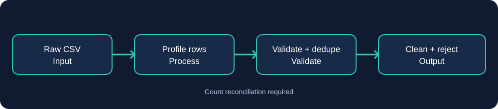

# ETL Optimisation & Data Quality — Quality Gate Demo

A small batch pipeline that profiles synthetic invoice rows, applies deterministic schema and value checks, removes duplicate business keys, and writes clean and rejected outputs.

> This is an independent local demo, not a client pipeline or benchmark. It makes no claims about production performance improvement.

## Run
python src/quality_gate.py --input data/raw_invoices.csv --output demo-output

## Outputs
- cleaned_invoices.csv
- rejected_rows.csv
- quality_summary.json

Checks are explicit and easy to adapt. Reconcile the rejected and cleaned row counts before downstream use.

## Bundled demo output

A sample run using the included fictional inputs is saved in `demo-output/`: cleaned_invoices.csv, rejected_rows.csv, quality_summary.json. Run commands from this project folder to regenerate the artifacts.
