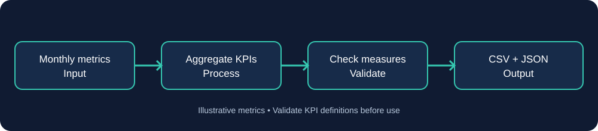

# Executive & Partner Performance BI — KPI Summary

A small, reproducible example of turning monthly operating records into partner-level KPI summaries.

> Synthetic training data only. This project does not represent an employer dashboard or production KPI model.

## Measures
- Revenue versus target and attainment percentage
- Client count and active headcount
- Month-level totals and partner ranking

## Run
python src/summarize_kpis.py --input data/monthly_metrics.csv --output outputs

The script writes a partner summary CSV and a concise JSON snapshot. Replace the illustrative metric definitions with documented business rules before using real data.