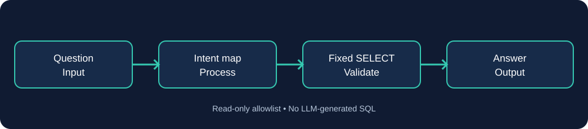

# GenAI Chat with SQL Database — Safe Query Router

A small conversational analytics prototype over an in-memory SQLite database with fictional orders. User phrases map to a fixed set of parameterized, read-only SQL statements.

> This prototype does not call a generative model or execute model-generated SQL. The fixed query allowlist is deliberate; it demonstrates a safe baseline before any LLM integration.

## Run the sample questions

    python src/chat_sql.py --questions-file data/example_questions.txt

For interactive mode, run python src/chat_sql.py without the option.

## Safety
- Creates an in-memory database from bundled synthetic rows.
- Executes only predefined SELECT queries.
- Rejects unsupported prompts rather than constructing arbitrary SQL.
- No network, credentials or external database.

## Bundled demo output

A sample run using the included fictional inputs is saved in `demo-output/`: sample-run.txt. Run commands from this project folder to regenerate the artifacts.
