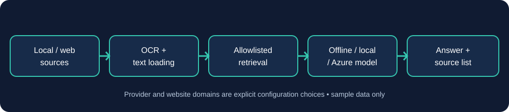

# Invoice Intelligence & Retrieval — Local Prototype

A transparent, offline prototype for finding relevant fictional invoice text and extracting a few fields with evidence snippets.

> Despite the portfolio case-study title, this implementation is a lexical retrieval baseline, not a deployed RAG system. It uses no LLM, embeddings, OCR, Azure service or external API.

## Run
python src/search_invoices.py --query "payment terms" --input data --output outputs

## What it demonstrates
- Token-based ranking of local text documents
- Simple field extraction with source evidence
- JSON output that can be reviewed against the source
- No fabricated values when a pattern is absent

All included invoice-like documents are fictional. Do not place real invoices or personal data in this demo.