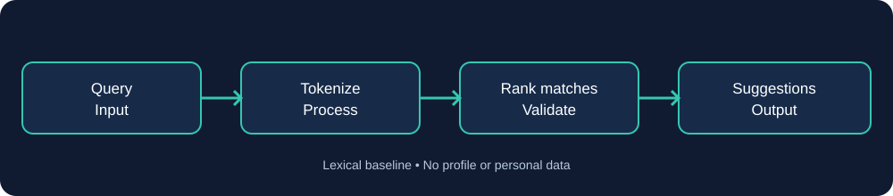

# NLP Chatbot & Recommendation Support — Local Text Matcher

A lightweight, offline baseline that scores FAQ entries and product descriptions by token overlap and returns the most relevant matches.

> This is a transparent lexical prototype, not a deployed chatbot or recommendation model. The catalog and FAQs are fictional.

## Run
python src/recommend.py --query "lightweight laptop for travel"

## What it demonstrates
- Basic text normalization and token matching
- Ranked FAQ/product suggestions
- A clear fallback when there is no useful match

A production system would need evaluation, privacy controls, a maintained knowledge source and user feedback.

## Bundled demo output

A sample run using the included fictional inputs is saved in `demo-output/`: sample-run.txt. Run commands from this project folder to regenerate the artifacts.
