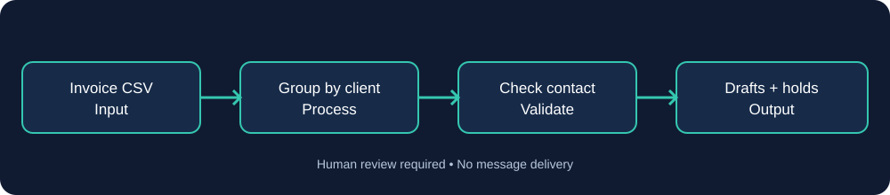

# Partner Communication Automation — Draft Generator

A review-first demo that groups overdue invoice rows into client-level communication drafts.

> This is an independent portfolio example with fictional records. It writes local drafts only; it never sends email or connects to Outlook, Power Automate, or an employer system.

## What it does
- Validates invoice amount, overdue days, recipient and identifiers.
- Groups eligible items by client reference.
- Produces one CSV row per client with a subject and draft body.
- Holds records with missing or conflicting recipient addresses.

## Run
python src/build_drafts.py --input data/sample_invoices.csv --output outputs

## Controls
Thresholds are command-line options. The draft file is an intermediate review artifact; verify totals, recipients and follow-up history before sending anything.