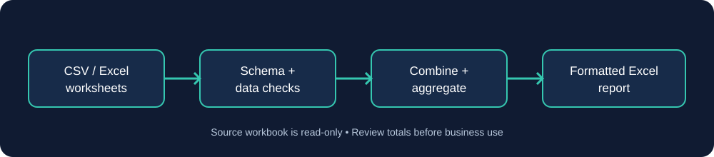

# Python Excel Automation

A reusable Excel automation utility that consolidates invoice rows from multiple worksheets, validates key fields, and creates a clean workbook with a detail sheet and client-level summary.

> Uses synthetic sample data. It does not connect to SharePoint, Outlook or any employer environment.



## Features

- Reads all worksheets from an input workbook.
- Standardises column names and validates required fields.
- Combines rows into one invoice detail table.
- Creates a client summary with invoice count and outstanding total.
- Saves a formatted Excel workbook.

## Run

```bash
python -m venv .venv
# Windows: .venv\\Scripts\\activate
# macOS/Linux: source .venv/bin/activate
pip install -r requirements.txt
python src/consolidate_workbooks.py --input data/sample_invoices.csv --output demo-output/consolidated_report.xlsx
```

## Input schema

Each worksheet (or the input CSV) should contain `client_name`, `invoice_no` and `outstanding_amount`. Extra columns are retained in the detail sheet.

## Output

- `Invoice_Detail`: combined and validated records.
- `Client_Summary`: invoice count and total outstanding by client.

## Safety

The script never emails files or modifies the source workbook. Review output totals before using the report for business decisions.

## Bundled demo output

A sample run using the included fictional inputs is saved in `demo-output/`: invoice_detail.csv, client_summary.csv (CSV fallback; Excel is generated when openpyxl is installed). Run commands from this project folder to regenerate the artifacts.

The checked-in demo output contains CSV previews because `openpyxl` was unavailable when it was generated. After installing `requirements.txt`, the command creates the formatted Excel workbook.
