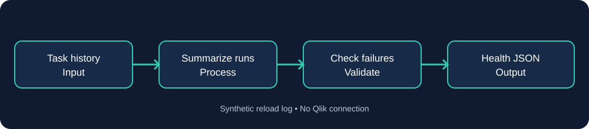

# QlikView & QMC BI Operations — Reload Health Summary

A lightweight simulation of BI reload monitoring from a CSV export. It summarizes run success and duration so operators can identify failed or slow tasks.

> This project does not connect to QlikView or QMC. The task history is synthetic and the metrics are illustrative.

## Run
python src/summarize_reload_health.py --input data/task_runs.csv --output outputs

## Metrics
Per app: run count, success count, failure count, success rate, and median runtime. Inspect individual failures in the source export before taking action.